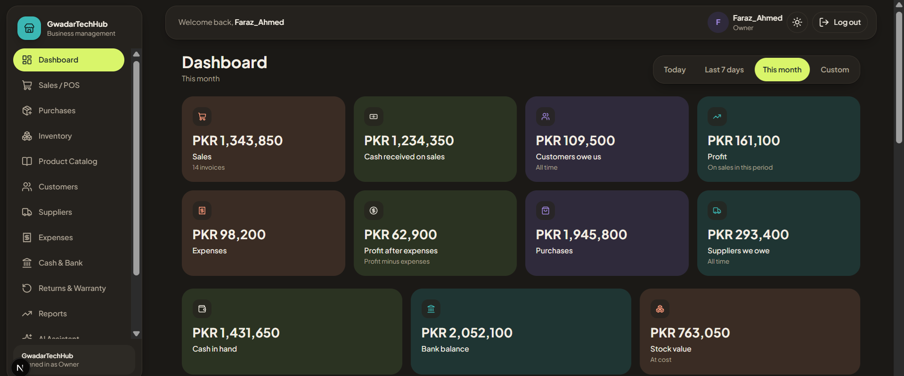
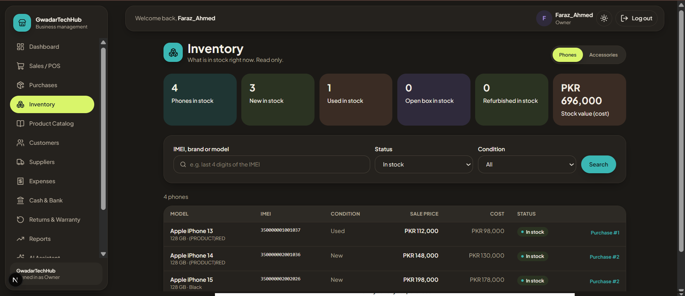
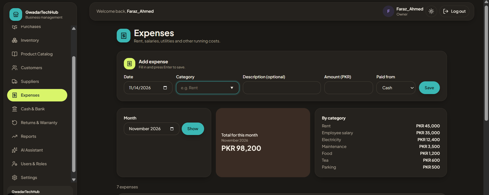
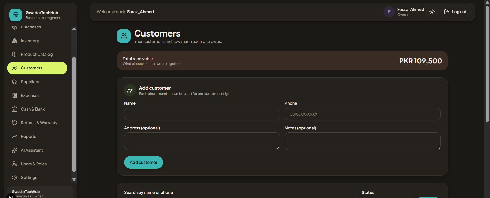
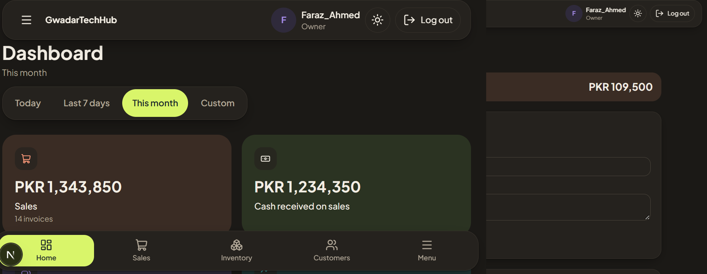
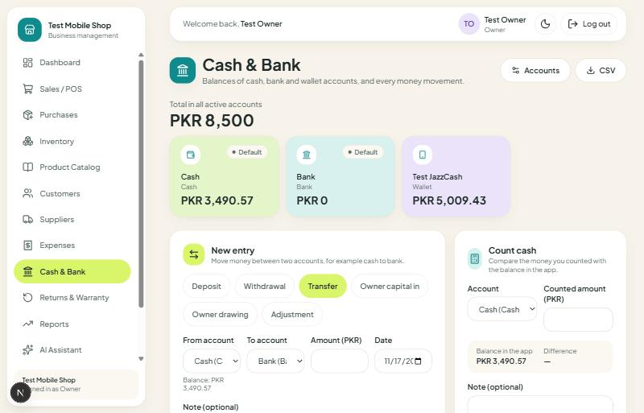
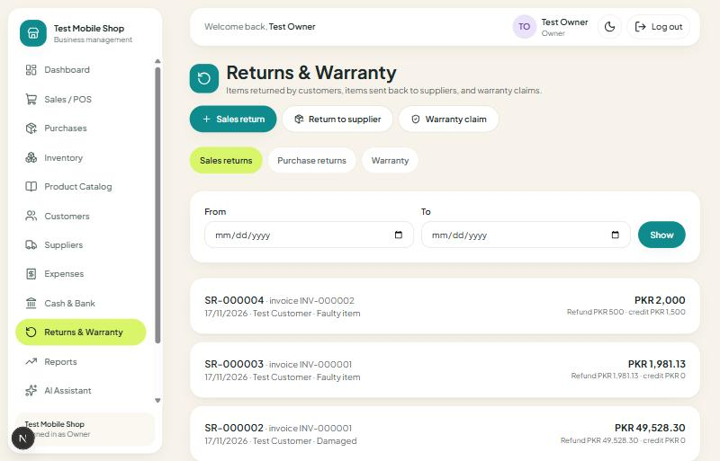
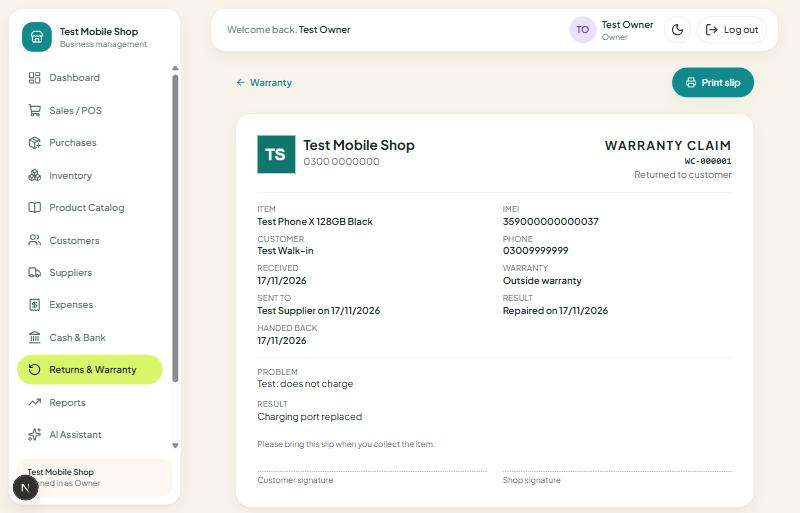
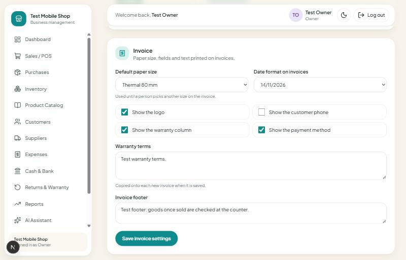

# Retail ERP & POS

A keyboard-first ERP and point-of-sale system for a mobile phone and accessories shop (Pakistan, PKR).


## Overview

Mobile phone shops often buy phones on credit from other shops and resell them within days. Every phone has to be tracked by its IMEI, stock has to go down the moment a sale is made, and the shop needs to know at any time how much it owes suppliers and how much customers owe it.

This app covers that daily flow:

- Phones are stocked and sold at IMEI level; accessories are tracked by quantity.
- Stock is reduced automatically when a sale is saved.
- If a customer wants an item that is not in stock, it can be added directly in the sale. The app then records the supplier purchase and the sale together in one transaction.

## Features

- **Sales / POS** – type-ahead item search with IMEI selection, line and invoice discounts, Cash or Bank payments, partial payments and customer credit.
- **Quick "not in stock" sale** – sell an item that is not in stock yet; the supplier purchase is created automatically.
- **Purchases** – fast grid entry with IMEI scanning, supplier credit and later supplier payments.
- **Inventory** – phones with IMEI, condition, cost and sale price; accessories with quantities and low-stock indication.
- **Customers and suppliers** – balances, payment history and detail pages.
- **Expenses** – fast entry with categories; expenses can be cancelled.
- **Dashboard** – period filter (Today / Last 7 days / This month / Custom) with sales, profit, receivables, payables, cash and bank balance and stock value.
- **Reports** – sales by day, top items, expenses by category, who owes what; print and CSV download.
- **Invoices** – automatic numbering (INV-000001), A4 and 80 mm thermal print, WhatsApp sharing and warranty text.
- **Cancel / void** – for sales, purchases and expenses; records are kept, never deleted.
- **Roles and permissions** – Owner, Manager and Sales roles with per-user permission overrides.
- **UI** – light and dark theme, responsive layout with a mobile bottom navigation.

### Settings

- Shop profile with a logo (PNG, JPEG or WebP up to 512 KB, stored in a Supabase Storage bucket per business).
- Invoice options that the invoice page uses: default paper size (A4 or 80 mm thermal), date format, which fields are shown, warranty terms and footer text.
- Low stock threshold used by the inventory and the dashboard, expense and product category management.
- "My account" page to change your own name and password.
- Data export: every table as CSV, or everything as one JSON file. This is a copy for your records; Supabase backups are separate.

### Cash & Bank

- Accounts for cash, banks and mobile wallets (for example JazzCash or Easypaisa), each with an opening balance.
- One default cash and one default bank account: the existing sales, purchases, payments and expenses post to them automatically.
- Manual entries: deposit, withdrawal, transfer between accounts, owner capital in, owner drawing and adjustment; money going out cannot make an account negative.
- Ledger with running balance, filters (account, dates, type), search, a day or month summary and CSV export.
- Cash count: compare the counted cash with the balance in the app and post the difference as an adjustment.
- Manual entries are cancelled with reversing entries; nothing is deleted.

### Returns & Warranty

- Sales returns from an invoice: choose items and quantities, put them back in stock or write them off, and pick the account for the refund. The returned value first reduces what the customer still owes; only the rest is refunded.
- Returns to the supplier for phones (by IMEI) and accessories; the supplier balance goes down or money comes back.
- An invoice or purchase that has returns can no longer be cancelled as a whole, so money is never paid back twice.
- Warranty lookup by IMEI, invoice number or customer phone, with days left.
- Warranty claims with a status flow (received, sent for repair, repaired / replaced / rejected, returned to the customer), history and a printable claim slip.
- Dashboard and reports subtract returns from sales, profit and purchases.

### AI Assistant

- Ask questions about the shop in English or Roman Urdu; answers stream in.
- Uses Claude through the Anthropic API from a server-only route. The assistant can only call a fixed list of read-only reports (sales, profit and expenses, stock, top products and customers, balances, cash and bank, warranty lookup) that read through the signed-in user's session, so Row Level Security and permissions apply. It cannot write anything.
- Per-user limits (20 questions per hour, 100 per day), input length limits, and customer phone numbers are masked before they are sent.
- Without an `ANTHROPIC_API_KEY` the page shows "AI Assistant is not configured yet".

## Screenshots

> Screenshots use generated demo data.

| | |
|---|---|
| <br>Dashboard with period filter | <br>New sale (POS) |
| <br>Invoice | <br>Purchase entry |
| <br>Inventory | <br>Reports |
| <br>Expenses | <br>Customers |
| <br>Dashboard on a phone | <br>New sale on a phone |
| <br>Cash & Bank | <br>Returns & Warranty |
| <br>Warranty claim slip | <br>Invoice settings |

## Tech stack

- [Next.js](https://nextjs.org) (App Router, Server Components, Server Actions)
- [React](https://react.dev)
- [TypeScript](https://www.typescriptlang.org)
- [Tailwind CSS](https://tailwindcss.com)
- [Supabase](https://supabase.com) – Postgres, Auth, Row Level Security and Storage
- [Anthropic TypeScript SDK](https://github.com/anthropics/anthropic-sdk-typescript) – AI Assistant (Claude)
- [lucide-react](https://lucide.dev) icons

## Architecture and security

- **Row Level Security** is enabled on every table; each user only reads what their permissions allow.
- **Stock and money writes** go through `SECURITY DEFINER` database functions that check permissions and run in a single transaction (sales, purchases, payments, expenses, cancellations).
- **The Supabase secret key is server-only.** It is used in one module guarded by `import "server-only"` and is never sent to the browser.
- **Money** is stored as `numeric` in the database and handled in the app as whole cents (`BigInt`), so totals have no floating point errors.
- **No hard deletes** – records are deactivated or voided instead of deleted.
- **Permission-based UI** – navigation items, pages and actions are shown only to users who may use them; every server action checks permissions again.

## Getting started

Prerequisites: [Node.js](https://nodejs.org) 20 or later and a [Supabase](https://supabase.com) project.

```bash
git clone https://github.com/farazdeveloper12/Retail-ERP-POS.git
cd Retail-ERP-POS
npm install
cp .env.example .env.local   # then fill in the values from your Supabase project
npm run dev
```

Open [http://localhost:3000](http://localhost:3000).

### Environment variables

| Variable | Where it is used |
|---|---|
| `NEXT_PUBLIC_SUPABASE_URL`, `NEXT_PUBLIC_SUPABASE_PUBLISHABLE_KEY` | Supabase project (browser and server) |
| `SUPABASE_SECRET_KEY` | Server only (user management) |
| `ANTHROPIC_API_KEY` | Server only (AI Assistant); optional |
| `ANTHROPIC_MODEL` | Optional Claude model for the AI Assistant (default `claude-opus-5-5`) |

### Database migrations

Schema changes live in `supabase/migrations/`. Each file is idempotent and runs as one transaction in the Supabase SQL Editor; it only adds objects and never deletes or changes existing amounts or dates. `supabase/go-live-checks.sql` is a read-only query to run before and after a migration to prove that existing totals did not change.

## Scripts

| Command | Description |
|---|---|
| `npm run dev` | Start the development server |
| `npm run build` | Create a production build |
| `npm run start` | Run the production build |
| `npm run lint` | Run ESLint |

## Project structure

```text
.
├── docs/
│   └── screenshots/      # README images
├── supabase/
│   ├── migrations/       # Idempotent SQL migrations
│   └── go-live-checks.sql
└── src/
    ├── app/
    │   ├── (app)/        # Signed-in pages: dashboard, sales, purchases, inventory, ...
    │   └── login/        # Sign-in page
    ├── components/       # Shared UI components, pickers and charts
    └── lib/              # Supabase clients, permissions, money and formatting helpers
```

## Roadmap

- Baseline schema script for a new installation
- Production deployment

## License

All rights reserved. The source is public for portfolio and review purposes.

## Author

**Faraz Ahmed** – [github.com/farazdeveloper12](https://github.com/farazdeveloper12)
