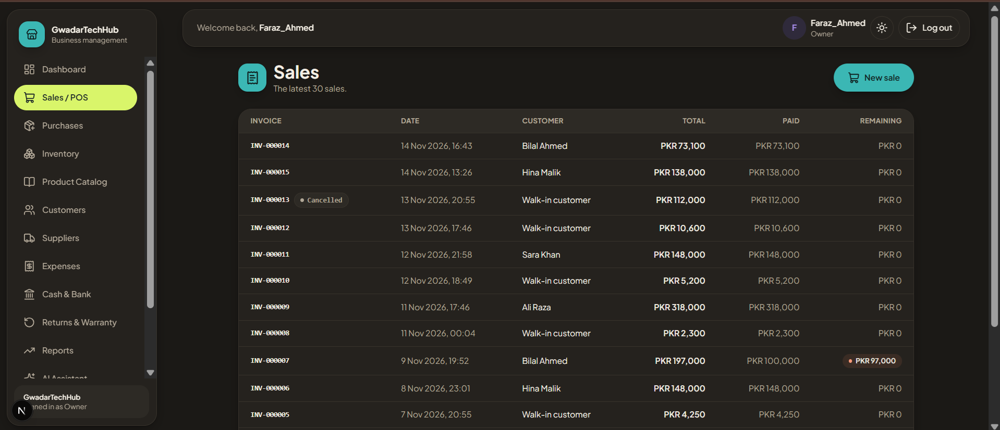
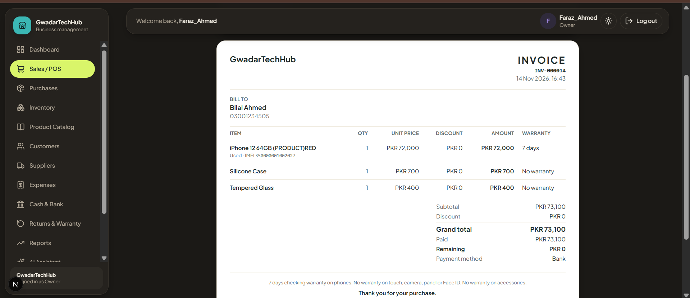
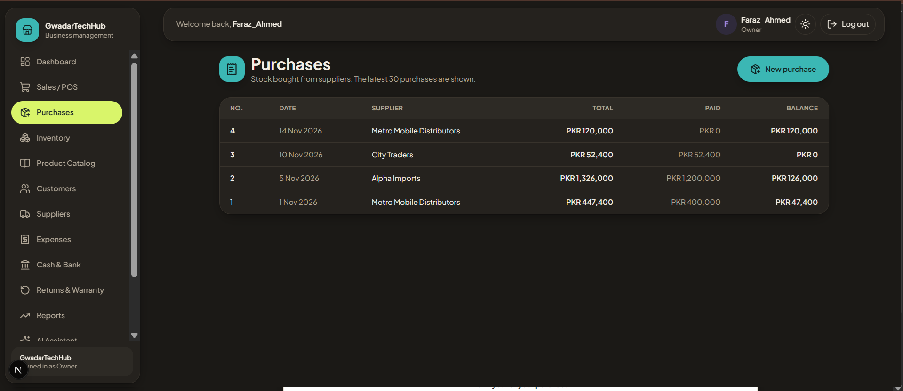
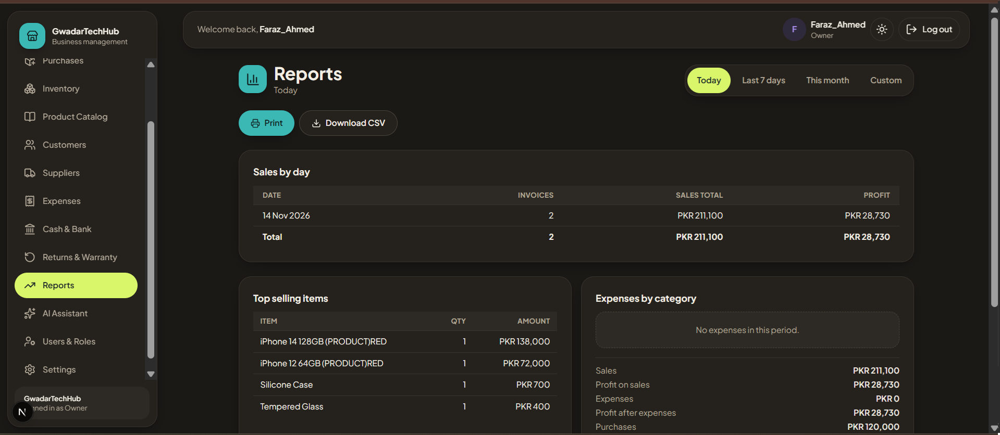
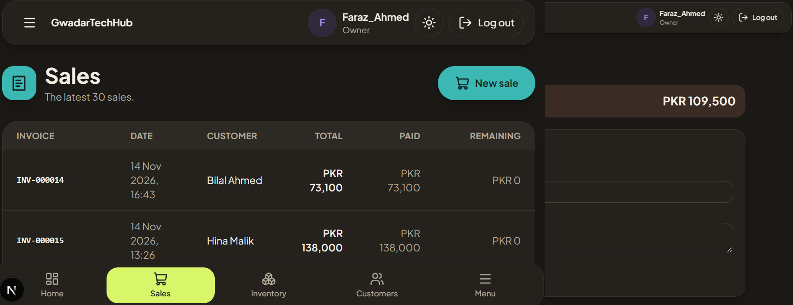

# Retail ERP & POS

A keyboard-first ERP and point-of-sale system for a mobile phone and accessories shop (Pakistan, PKR).


## Overview

Mobile phone shops often buy phones on credit from other shops and resell them within days. Every phone has to be tracked by its IMEI, stock has to go down the moment a sale is made, and the shop needs to know at any time how much it owes suppliers and how much customers owe it.

This app covers that daily flow:

- Phones are stocked and sold at IMEI level; accessories are tracked by quantity.
- Stock is reduced automatically when a sale is saved.
- If a customer wants an item that is not in stock, it can be added directly in the sale. The app then records the supplier purchase and the sale together in one transaction.

## Features

- **Sales / POS** – type-ahead item search with IMEI selection, line and invoice discounts, Cash or Bank payments, partial payments and customer credit.
- **Quick "not in stock" sale** – sell an item that is not in stock yet; the supplier purchase is created automatically.
- **Purchases** – fast grid entry with IMEI scanning, supplier credit and later supplier payments.
- **Inventory** – phones with IMEI, condition, cost and sale price; accessories with quantities and low-stock indication.
- **Customers and suppliers** – balances, payment history and detail pages.
- **Expenses** – fast entry with categories; expenses can be cancelled.
- **Dashboard** – period filter (Today / Last 7 days / This month / Custom) with sales, profit, receivables, payables, cash and bank balance and stock value.
- **Reports** – sales by day, top items, expenses by category, who owes what; print and CSV download.
- **Invoices** – automatic numbering (INV-000001), A4 and 80 mm thermal print, WhatsApp sharing and warranty text.
- **Cancel / void** – for sales, purchases and expenses; records are kept, never deleted.
- **Roles and permissions** – Owner, Manager and Sales roles with per-user permission overrides.
- **UI** – light and dark theme, responsive layout with a mobile bottom navigation.

## Screenshots

> Screenshots use generated demo data.

| | |
|---|---|
| <br>Dashboard with period filter | <br>New sale (POS) |
| <br>Invoice | <br>Purchase entry |
| <br>Inventory | <br>Reports |
| <br>Expenses | <br>Customers |
| <br>Dashboard on a phone | <br>New sale on a phone |

## Tech stack

- [Next.js](https://nextjs.org) (App Router, Server Components, Server Actions)
- [React](https://react.dev)
- [TypeScript](https://www.typescriptlang.org)
- [Tailwind CSS](https://tailwindcss.com)
- [Supabase](https://supabase.com) – Postgres, Auth and Row Level Security
- [lucide-react](https://lucide.dev) icons

## Architecture and security

- **Row Level Security** is enabled on every table; each user only reads what their permissions allow.
- **Stock and money writes** go through `SECURITY DEFINER` database functions that check permissions and run in a single transaction (sales, purchases, payments, expenses, cancellations).
- **The Supabase secret key is server-only.** It is used in one module guarded by `import "server-only"` and is never sent to the browser.
- **Money** is stored as `numeric` in the database and handled in the app as whole cents (`BigInt`), so totals have no floating point errors.
- **No hard deletes** – records are deactivated or voided instead of deleted.
- **Permission-based UI** – navigation items, pages and actions are shown only to users who may use them; every server action checks permissions again.

## Getting started

Prerequisites: [Node.js](https://nodejs.org) 20 or later and a [Supabase](https://supabase.com) project.

```bash
git clone https://github.com/farazdeveloper12/retail-erp-pos.git
cd retail-erp-pos
npm install
cp .env.example .env.local   # then fill in the values from your Supabase project
npm run dev
```

Open [http://localhost:3000](http://localhost:3000).

> The database schema scripts are not included in this repository yet; they will be added under a `supabase/` folder.

## Scripts

| Command | Description |
|---|---|
| `npm run dev` | Start the development server |
| `npm run build` | Create a production build |
| `npm run start` | Run the production build |
| `npm run lint` | Run ESLint |

## Project structure

```text
.
├── docs/
│   └── screenshots/      # README images
└── src/
    ├── app/
    │   ├── (app)/        # Signed-in pages: dashboard, sales, purchases, inventory, ...
    │   └── login/        # Sign-in page
    ├── components/       # Shared UI components, pickers and charts
    └── lib/              # Supabase clients, permissions, money and formatting helpers
```

## Roadmap

- Returns and warranty claims
- Cash and bank ledger page
- AI assistant
- Database migrations folder (`supabase/`)
- Production deployment

## License

All rights reserved. The source is public for portfolio and review purposes.

## Author

**Faraz Ahmed** – [github.com/farazdeveloper12](https://github.com/farazdeveloper12)
